# UPI Payments Data Pipeline on AWS (S3 + Python + Athena)

Batch ELT pipeline for a UPI (India's instant payments system) transaction feed.
Ingests raw transaction records, validates them against business rules (invalid rows go to a
quarantine zone with a rejection reason), standardizes bank names, pseudonymizes customer IDs,
models a star schema in month-partitioned Parquet on S3, and serves it via Athena SQL.

> **About the data:** Row-level UPI data is not public (NPCI only publishes aggregates), so
> `00_generate_data.py` simulates the source system: ~500K transactions across 2025, with
> realistic distributions (banks, states, merchant categories, peak hours, UPI Rs 1,00,000 limit)
> and deliberately injected data problems (duplicates, nulls, invalid timestamps, negative
> amounts, inconsistent bank names, self-transfers).

## Star schema
- **fact_transactions** (grain: one UPI transaction): txn_id, txn_ts, date_key, txn_hour, txn_type, amount_inr, status, failure_reason, sender_key, receiver_key, sender_bank_id, receiver_bank_id, category_id, sender_state, device_type, is_flagged, is_high_value, is_night | partitioned by txn_month
- **dim_bank**: bank_id, bank_name
- **dim_category**: category_id, category_name
- **dim_date**: date_key, full_date, day_name, month_num, quarter, is_weekend

## Validation rules (rejects are quarantined, not silently dropped)
missing required field, duplicate txn_id, invalid timestamp, timestamp out of range,
invalid / non-positive amount, amount above UPI limit (Rs 1,00,000), self-transfer, invalid type/status.

### S3 layout
Three zones: `raw/` (source CSV), `curated/` (star-schema Parquet) and `rejected/` (quarantined rows with reasons).

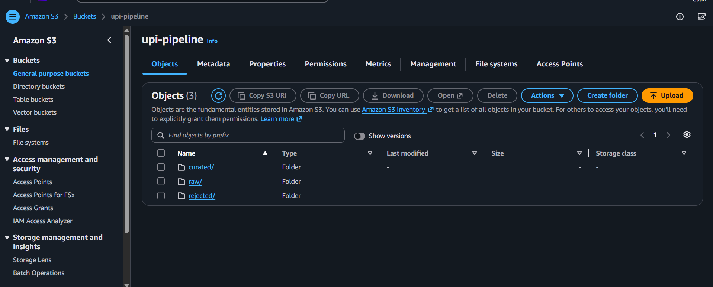

### Q1: Monthly volume, success rate and month-over-month growth (CTE + LAG)
Monthly volume stays at roughly 38K-42K transactions with success rates of 95.2%-95.7%.

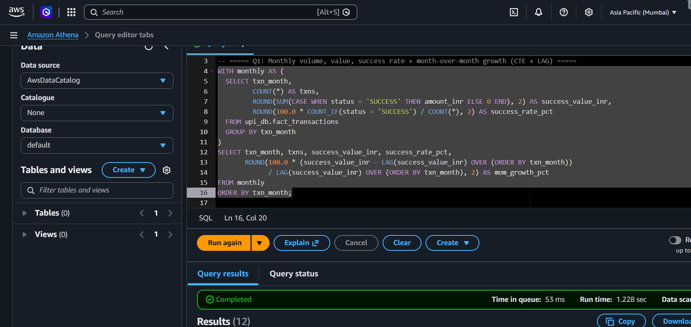
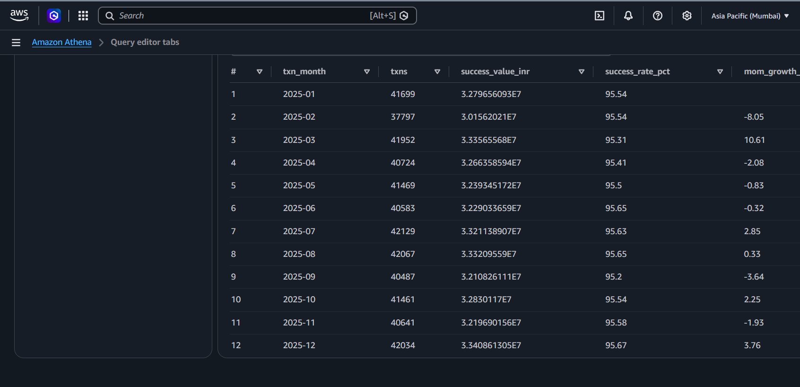

### Q2: Failure rate by sender bank, ranked (join + window RANK)
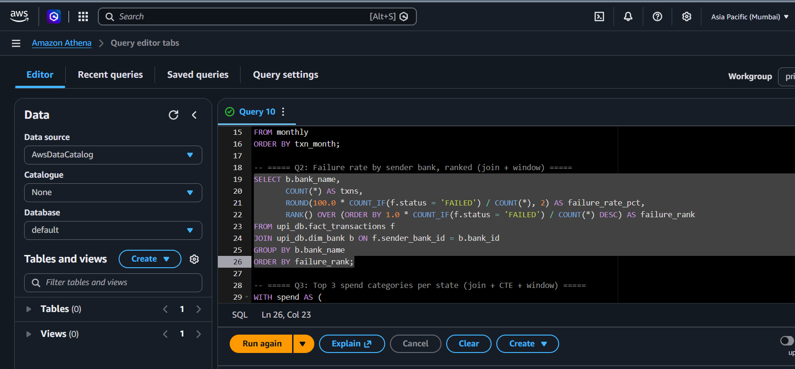
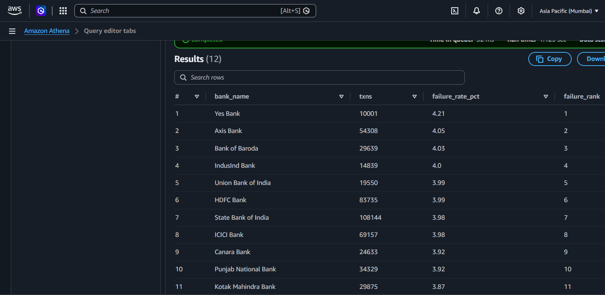

### Q3: Top 3 spend categories per state (join + CTE + window RANK)
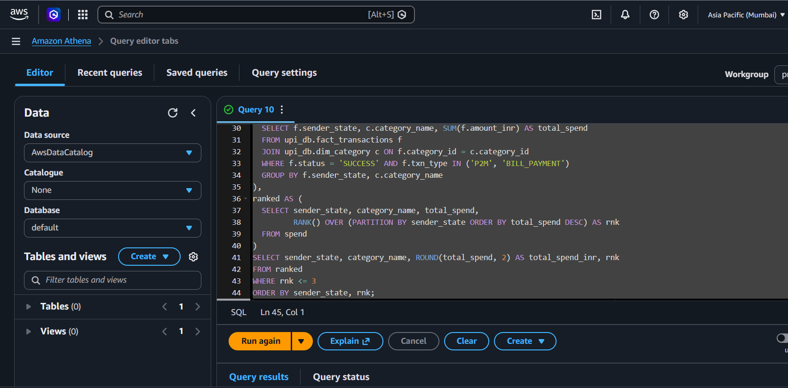
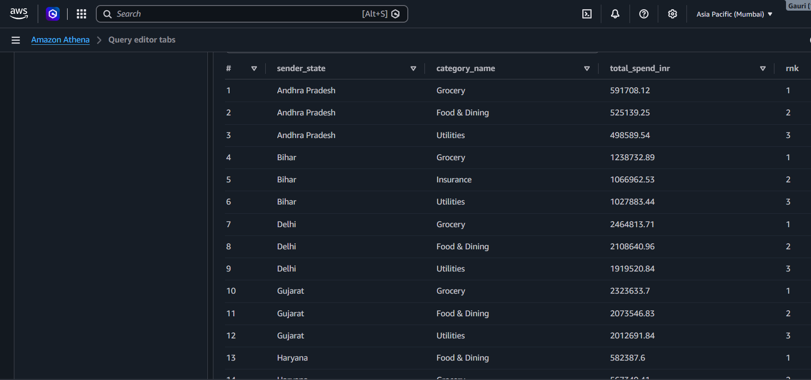

### Q4: Weekday vs weekend average ticket size by transaction type (join)
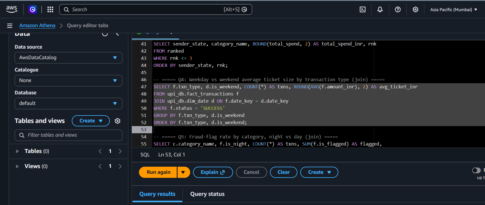
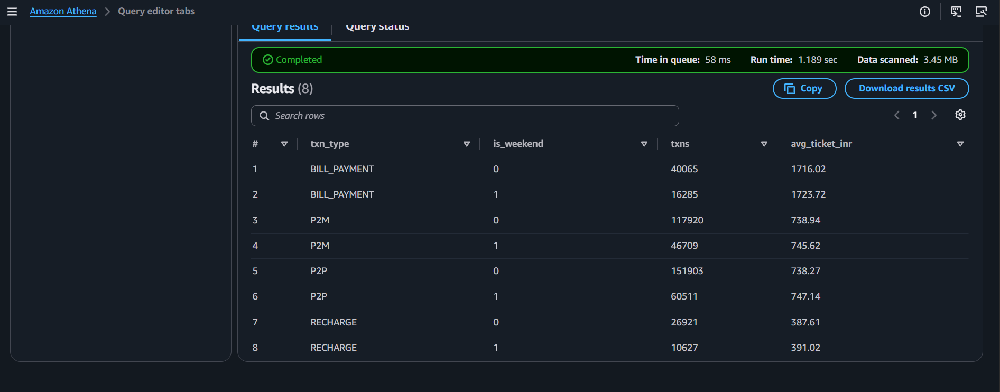

### Q5: Fraud-flag rate by category, night vs day (join)
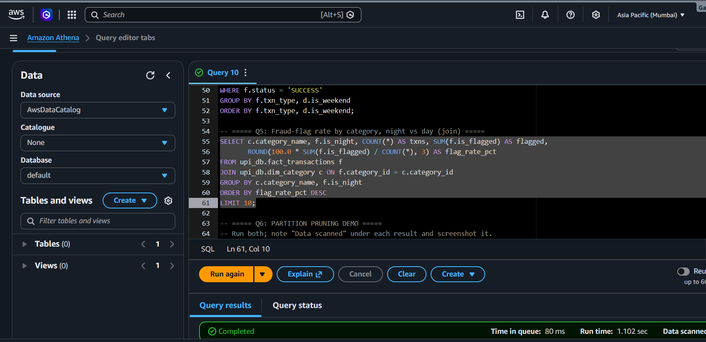
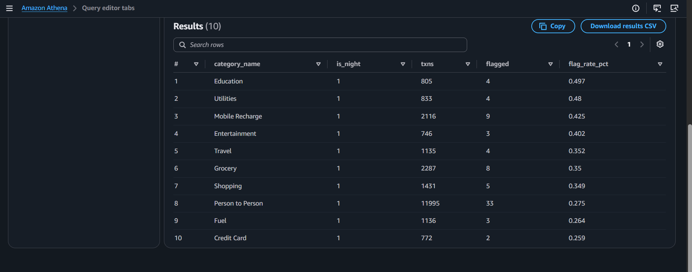

### Q6: Partition pruning (full scan vs single month)
Same aggregate with and without `WHERE txn_month = '2025-06'`.
Data scanned: **TODO MB** (full table) vs **TODO MB** (one partition). Fill from Athena -> Recent queries.

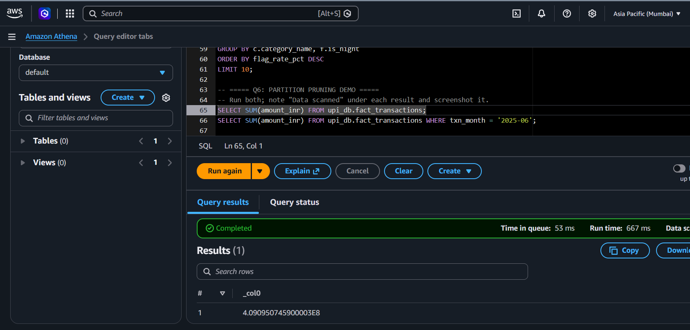
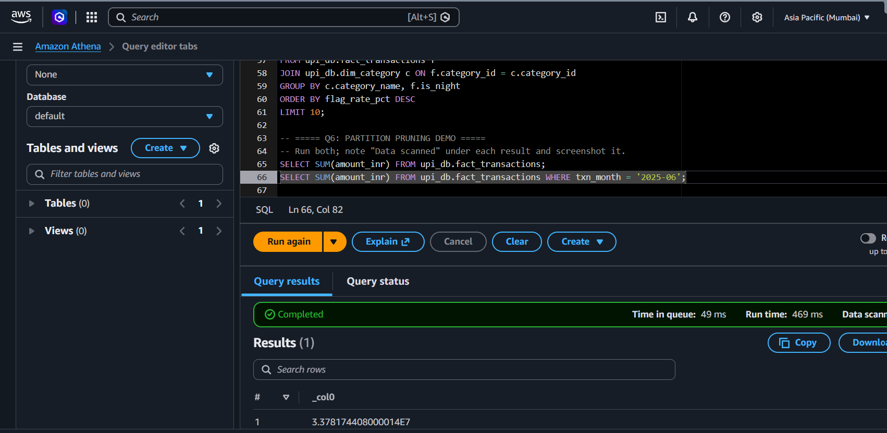

### Data quality
N/N checks passed (see `data/quality_report.txt`).
